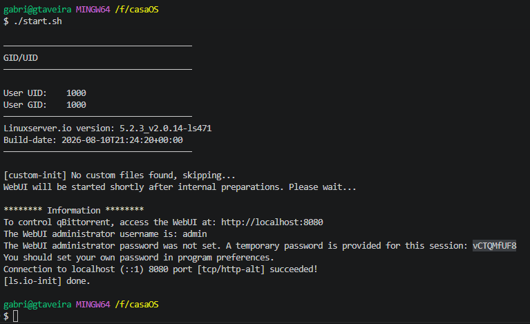
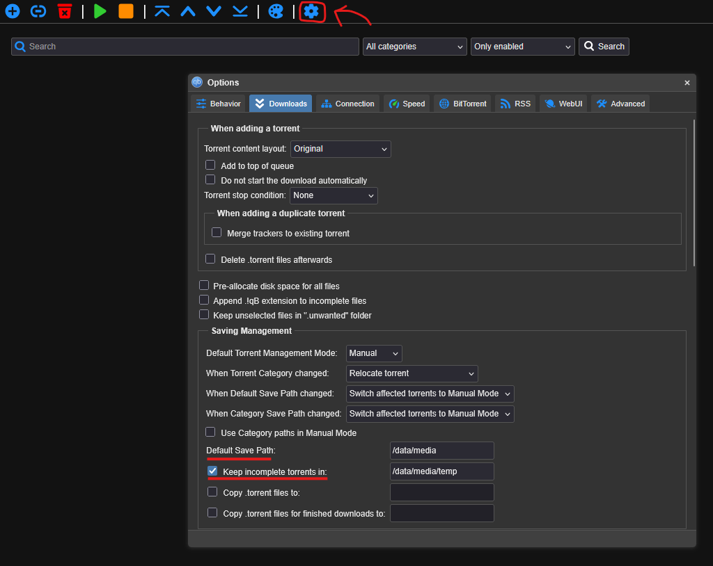

# Jellyfin + Qbittorrent

## Requirements
- Docker installed.

## Setup
- Run the `setup.sh` script to create the necessary folders for configuration.
- Run the `start.sh` script to boot up the servers.
- Access qbittorrent at http://localhost:8080 and log in using the username as `admin` and the password as shown for the session on the terminal. If the temporary password is not being shown at the terminal, run the command below:
```sh
docker logs qbittorrent
```

- Click on the options icon, go to `Downloads`: 
    - Set the `Default Save Path` to `/data/media`
    - Check the `Keep incomplete torrents in:` option and set it to `/data/media/temp`.
    - Scroll all the way down and click `save`.


## Recommended Plugins
AcademicTorrents
AniDex
MagnetDL
MaxiTorrent
SolidTorrents
The Pirate Bay
The RarBg
TourBittorrent